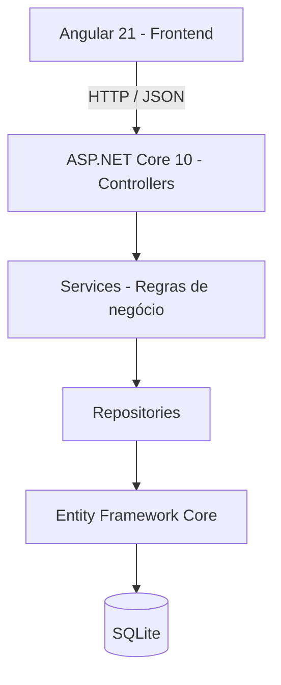

# Gestão de Pedidos — Dashboard Operacional

Sistema Full Stack para gerenciamento de clientes, produtos e pedidos, com controle de estoque, acompanhamento de status e dashboard operacional.

Desenvolvido como parte de um teste técnico Full Stack, utilizando **ASP.NET Core 10**, **Angular 21**, **Entity Framework Core** e **SQLite**.

## 1. Tecnologias utilizadas

### Backend
- .NET 10 / ASP.NET Core Web API
- C#
- Entity Framework Core
- SQLite
- Swagger / OpenAPI
- Serilog
- Testes automatizados

### Frontend
- Angular 21
- TypeScript
- Angular Material
- RxJS
- Angular Signals
- Reactive Forms
- Vitest

## 2. Funcionalidades

### Clientes
- Cadastro de clientes
- Listagem de clientes
- Edição de informações
- Exclusão com confirmação
- Validação dos campos obrigatórios e do e-mail
- Paginação, busca por nome/e-mail e ordenação por nome/data de cadastro

### Produtos
- Cadastro e edição de produtos
- Consulta de produtos
- Controle de estoque
- Ativação e desativação de produtos
- Exclusão com confirmação
- Paginação, busca por nome, filtro de situação (ativo/inativo) e ordenação por nome/preço/estoque

### Pedidos
- Criação de pedidos vinculados a clientes
- Inclusão de múltiplos produtos
- Validação da disponibilidade de estoque
- Cálculo automático do valor total
- Atualização de status
- Cancelamento de pedidos com confirmação
- Devolução ao estoque dos itens de pedidos cancelados
- Listagem paginada
- Filtro por status e nome do cliente
- Ordenação por data e valor

### Dashboard
- Total de pedidos
- Faturamento total
- Ticket médio
- Distribuição de pedidos por status
- Cinco produtos mais vendidos
- Atualização automática a cada 30 segundos
- Atualização manual dos indicadores

## 3. Arquitetura



O backend utiliza uma arquitetura em camadas:

**Controller → Service → Repository → Banco de dados**

- **Controllers:** recebem requisições HTTP e retornam as respostas da API.
- **Services:** implementam as regras de negócio.
- **Repositories:** realizam operações de persistência.
- **Entities:** representam as entidades do domínio.
- **DTOs:** definem os contratos de entrada e saída da API.
- **Middleware:** centraliza o tratamento de exceções.

O frontend utiliza componentes standalone, organizados por funcionalidade, com separação entre páginas, serviços e modelos.

## 4. Estrutura do repositório

```text
GestaoPedidos/
├── .config/
│   └── dotnet-tools.json
├── backend/
│   ├── GestaoPedidos.slnx
│   ├── GestaoPedidos.API/
│   │   ├── Controllers/
│   │   ├── Data/
│   │   ├── DTOs/
│   │   │   ├── Clientes/
│   │   │   ├── Common/
│   │   │   ├── Dashboard/
│   │   │   ├── Pedidos/
│   │   │   └── Produtos/
│   │   ├── Entities/
│   │   ├── Enums/
│   │   ├── Exceptions/
│   │   ├── Mappers/
│   │   ├── Middlewares/
│   │   ├── Migrations/
│   │   ├── Repositories/
│   │   │   └── Interfaces/
│   │   ├── Services/
│   │   │   └── Interfaces/
│   │   ├── Validators/
│   │   └── Program.cs
│   └── GestaoPedidos.Tests/
│       ├── Integration/
│       └── Services/
├── frontend/
│   ├── src/
│   │   ├── app/
│   │   │   ├── core/
│   │   │   │   ├── interceptors/
│   │   │   │   ├── models/
│   │   │   │   └── services/
│   │   │   ├── features/
│   │   │   │   ├── clientes/
│   │   │   │   ├── dashboard/
│   │   │   │   ├── pedidos/
│   │   │   │   └── produtos/
│   │   │   └── shared/
│   │   │       └── components/
│   │   └── environments/
│   ├── angular.json
│   └── package.json
├── .gitignore
└── README.md
```

O backend segue a separação em camadas de Controllers, Services e Repositories. Os testes automatizados ficam em um projeto independente, `GestaoPedidos.Tests`, organizados em testes de integração e testes de serviços.

O frontend utiliza uma organização por funcionalidades, separando páginas, modelos e serviços, além de componentes compartilhados e recursos comuns da aplicação.

## 5. Pré-requisitos

Para executar o projeto localmente, é necessário ter:

- .NET SDK 10
- Node.js 22 ou versão compatível com Angular 21
- npm
- Angular CLI 21
- Git

O banco de dados utilizado é o SQLite, portanto não é necessário instalar um servidor de banco de dados.

## 6. Executando o backend

Abra um terminal na raiz do repositório e restaure as ferramentas locais do .NET:

```powershell
dotnet tool restore
```

Acesse a pasta do projeto da API:

```powershell
cd backend/GestaoPedidos.API
```

Restaure as dependências:

```powershell
dotnet restore
```

Aplique as migrations do Entity Framework Core:

```powershell
dotnet ef database update
```

### Migrations e dados iniciais (Seed)

O projeto utiliza Entity Framework Core com SQLite para persistência dos dados.

A estrutura do banco de dados e os dados iniciais são configurados por meio das migrations. Ao executar `dotnet ef database update`, o Entity Framework Core aplica as migrations pendentes, incluindo `SeedClientesProdutos`.

Essa migration insere automaticamente três clientes e cinco produtos de exemplo, com preços, estoques e situações iniciais definidos, permitindo testar a aplicação sem a necessidade de cadastrar todos os registros manualmente.

As migrations e o seed são executados pelo comando de atualização do banco, não automaticamente ao iniciar a API. Em um banco já atualizado, o comando não reaplica a migration de seed.

Execute a aplicação:

```powershell
dotnet run
```

Na configuração de desenvolvimento utilizada neste projeto, a API é executada em:

`http://localhost:5245`

Swagger:

`http://localhost:5245/swagger`

A documentação interativa dos endpoints pode ser consultada pelo Swagger, quando habilitado no ambiente de desenvolvimento.

O banco SQLite é utilizado para persistência de clientes, produtos e pedidos.

## 7. Executando o frontend

Em outro terminal, acesse a pasta do Angular:

```powershell
cd frontend
```

Instale as dependências:

```powershell
npm install
```

Inicie o servidor de desenvolvimento:

```powershell
npm start
```

Acesse:

`http://localhost:4200`

O frontend está configurado para consumir a API em:

`http://localhost:5245/api`

Essa URL é definida no arquivo `frontend/src/environments/environment.ts`.

**Importante:** mantenha o backend em execução enquanto utiliza o frontend.

## 8. Endpoints principais

### Clientes

| Método | Endpoint | Descrição |
|---|---|---|
| GET | `/api/clientes` | Listar clientes |
| GET | `/api/clientes/paginado` | Listar clientes com paginação, filtros e ordenação |
| GET | `/api/clientes/{id}` | Consultar cliente |
| POST | `/api/clientes` | Cadastrar cliente |
| PUT | `/api/clientes/{id}` | Atualizar cliente |
| DELETE | `/api/clientes/{id}` | Excluir cliente |

### Produtos

| Método | Endpoint | Descrição |
|---|---|---|
| GET | `/api/produtos` | Listar produtos |
| GET | `/api/produtos/paginado` | Listar produtos com paginação, filtros e ordenação |
| GET | `/api/produtos/{id}` | Consultar produto |
| POST | `/api/produtos` | Cadastrar produto |
| PUT | `/api/produtos/{id}` | Atualizar produto |
| DELETE | `/api/produtos/{id}` | Excluir produto |

### Pedidos

| Método | Endpoint | Descrição |
|---|---|---|
| GET | `/api/pedidos` | Listar e filtrar pedidos |
| GET | `/api/pedidos/{id}` | Consultar pedido |
| POST | `/api/pedidos` | Criar pedido |
| PATCH | `/api/pedidos/{id}/status` | Atualizar status |
| PATCH | `/api/pedidos/{id}/cancelar` | Cancelar pedido |

### Dashboard

| Método | Endpoint | Descrição |
|---|---|---|
| GET | `/api/dashboard` | Consultar indicadores operacionais |

## 9. Regras de negócio

### Fluxo de status

```text
Pendente → Pago → Enviado → Entregue
    |
    └────→ Cancelado
```

O cancelamento é permitido apenas enquanto o pedido estiver pendente.

### Controle de estoque

Ao criar um pedido, o sistema valida a disponibilidade dos produtos e desconta as quantidades solicitadas do estoque.

Quando um pedido pendente é cancelado, as quantidades reservadas são devolvidas ao estoque.

### Indicadores financeiros

O faturamento total considera os pedidos com status Pago, Enviado ou Entregue.

Pedidos pendentes e cancelados não entram no cálculo do faturamento.

## 10. Testes automatizados

### Backend

A partir da raiz do projeto, acesse a pasta `backend` e execute:

```powershell
cd backend
dotnet test
```

A suíte de testes automatizados do backend contempla **40 testes**, incluindo validações de regras de negócio, operações de CRUD, gerenciamento de estoque, transições de status dos pedidos e tratamento de cenários inválidos.

### Frontend

Acesse a pasta `frontend` e execute:

```powershell
npm test -- --watch=false
```

A suíte frontend contempla **42 testes**, incluindo:

- Inicialização da aplicação
- Serviço HTTP de pedidos
- Dashboard
- Gerenciamento de produtos
- Gerenciamento de clientes
- Paginação e filtros de clientes e produtos

Para validar a compilação de produção:

```powershell
npm run build
```

### Validação do fluxo integrado

O fluxo integrado foi validado manualmente, contemplando a criação de um produto com estoque inicial de 5 unidades, a criação de um pedido com 3 unidades, a rejeição de uma segunda compra com quantidade superior ao estoque disponível e o cancelamento do primeiro pedido, com devolução das unidades ao estoque.

Também foi verificada a atualização dos indicadores do dashboard após as operações.

Adicionalmente, foi realizado um teste manual de concorrência utilizando duas abas do navegador, confirmando que o backend impede a venda de quantidades superiores ao estoque disponível.

Também foi validada a restrição de exclusão de clientes com pedidos associados. Nessa situação, a API retorna HTTP 409 (Conflict) com uma mensagem explicativa, apresentada ao usuário no frontend. Clientes sem pedidos associados podem ser excluídos normalmente.

### Cobertura de testes do backend

A cobertura dos testes automatizados do backend foi medida utilizando **Coverlet** e **ReportGenerator**.

Os quatro Services de negócio alcançaram uma cobertura agregada de **73,5% das linhas executáveis**.

| Service | Cobertura de linhas |
|---|---:|
| ClienteService | 78,6% |
| DashboardService | 100% |
| PedidoService | 68,0% |
| ProdutoService | 76,7% |
| **Cobertura agregada** | **73,5%** |

A cobertura agregada corresponde a **211 de 287 linhas executáveis** dos Services de negócio.

#### Como reproduzir a cobertura

O projeto utiliza o pacote `coverlet.collector` para coletar a cobertura dos testes e o **ReportGenerator** para gerar o relatório HTML.

O ReportGenerator está registrado como ferramenta local no arquivo `.config/dotnet-tools.json`, juntamente com o `dotnet-ef`.

A instalação dessas ferramentas é realizada pelo comando `dotnet tool restore`, já apresentado na seção 6 deste README. Portanto, **não é necessária uma instalação global adicional do ReportGenerator**.

A partir da pasta `backend`, execute:

**1. Executar os testes e coletar a cobertura:**

```powershell
dotnet test --collect:"XPlat Code Coverage"
```

**2. Gerar o relatório HTML:**

```powershell
dotnet tool run reportgenerator -- "-reports:GestaoPedidos.Tests/TestResults/**/coverage.cobertura.xml" "-targetdir:CoverageReport" "-reporttypes:Html"
```

**3. Abrir o relatório:**

```powershell
start CoverageReport/index.html
```

O relatório gerado estará disponível em:

`backend/CoverageReport/index.html`

As pastas `TestResults/` e `CoverageReport/` são geradas automaticamente e estão excluídas do versionamento pelo `.gitignore`.

**Observação:** os percentuais apresentados consideram exclusivamente os quatro Services de negócio, e não a cobertura geral da API.

## 11. Tratamento de erros

O backend possui tratamento centralizado de exceções, com respostas HTTP adequadas para erros de validação, recursos inexistentes e conflitos de negócio.

O frontend utiliza um interceptor HTTP para apresentar mensagens de erro ao usuário por meio de notificações do Angular Material.

Os erros são tratados sem depender de dados simulados nas funcionalidades da aplicação.

## 12. Considerações técnicas

- O SQLite foi escolhido para simplificar a instalação e a execução local.
- A arquitetura em camadas facilita a manutenção e a evolução das regras de negócio.
- Os DTOs evitam expor diretamente as entidades de persistência.
- Os componentes standalone simplificam a organização do Angular.
- Os Signals gerenciam o estado local das telas.
- O RxJS é utilizado nas requisições HTTP e na atualização periódica do dashboard.
- O Angular Material fornece componentes de interface reutilizáveis.


## 13. Controle de concorrência e atomicidade dos pedidos

Para evitar vendas acima do estoque disponível em operações simultâneas, o sistema utiliza atualizações condicionais diretamente no banco de dados, por meio do `ExecuteUpdateAsync` do Entity Framework Core.

O desconto do estoque é realizado apenas quando o produto está ativo e possui quantidade suficiente. A operação utiliza a condição `EstoqueAtual >= Quantidade`, decrementando o saldo diretamente no banco. Caso nenhuma linha seja atualizada, a criação do pedido é interrompida.

A criação do pedido e as atualizações de estoque são executadas dentro de uma transação explícita. Se alguma operação falhar, o sistema executa um rollback, impedindo a persistência parcial dos dados.

O cancelamento segue o mesmo princípio: o status é atualizado condicionalmente de `Pendente` para `Cancelado`, e a devolução das quantidades ao estoque ocorre dentro da mesma transação. Isso impede a devolução duplicada em cancelamentos concorrentes.

**Estratégia adotada:** atualização condicional atômica com transações de banco de dados, utilizando EF Core e SQLite.

**Trade-off:** essa abordagem oferece consistência com baixa complexidade para a aplicação proposta. Em cenários de alta concorrência, o SQLite pode apresentar maior contenção de escrita, sendo recomendável avaliar um banco como PostgreSQL, além de políticas de retry para conflitos transitórios.


## 14. Decisões de Design e Evolução da Arquitetura

### 1. Escalabilidade

**Se o sistema precisasse suportar 100 vezes mais pedidos por dia, o que mudaria na arquitetura?**

Inicialmente, migraria o banco SQLite para PostgreSQL, que oferece melhores recursos para operações concorrentes e maior volume de transações. Manteria a separação entre Controllers, Services e Repositories, permitindo escalar horizontalmente a API. Também implementaria cache para consultas frequentes, especialmente os indicadores do dashboard, e avaliaria o uso de processamento assíncrono para operações não críticas.

### 2. Resiliência e atomicidade

**Como garantir que a criação de pedidos seja atômica e como tratar falhas parciais?**

A implementação atual utiliza transações explícitas do Entity Framework Core para garantir que a criação do pedido e a atualização do estoque sejam concluídas conjuntamente. O estoque é atualizado por operações condicionais, evitando que requisições simultâneas consumam quantidades indisponíveis. Caso alguma etapa falhe, a transação é revertida por rollback, impedindo que um pedido seja persistido com estoque inconsistente. Para maior resiliência, adicionaria políticas de retry controladas para falhas transitórias, respeitando a segurança das operações.

### 3. Evolução para notificações

**Se fosse necessário enviar e-mails quando o status de um pedido mudasse, onde essa funcionalidade seria integrada?**

Criaria uma interface `INotificacaoService` na camada de serviços, responsável por definir o contrato de envio de notificações, com uma implementação específica para e-mails. O `PedidoService` continuaria responsável pelas regras de negócio e acionaria o serviço de notificações após a atualização bem-sucedida do status no banco de dados. O envio seria tratado separadamente, com registro de erros, para que uma falha no e-mail não impedisse a atualização do pedido. Caso o sistema precisasse de maior confiabilidade, adicionaria uma tabela de notificações pendentes e um processo em segundo plano para tentar novamente os envios que falhassem.

## 15. Melhorias futuras

- Autenticação e autorização
- Testes end-to-end
- Filtros adicionais nos relatórios
- Atualizações em tempo real com SignalR
- Containerização com Docker
- Pipeline de integração contínua
